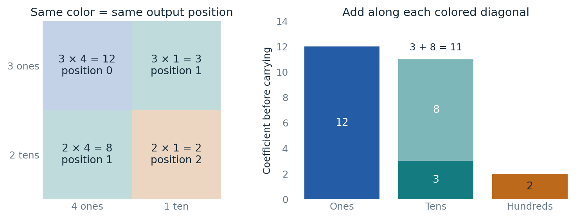
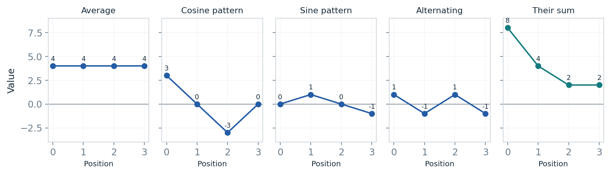
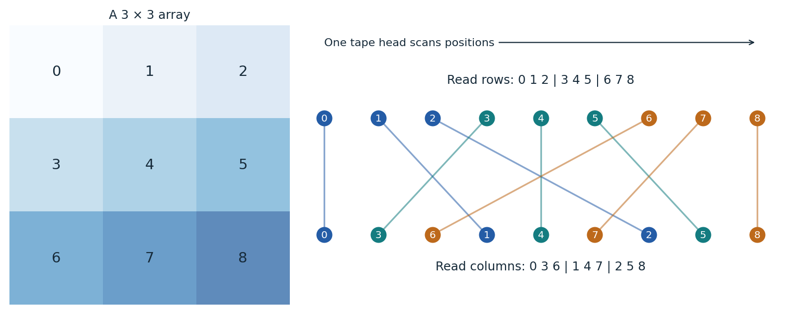
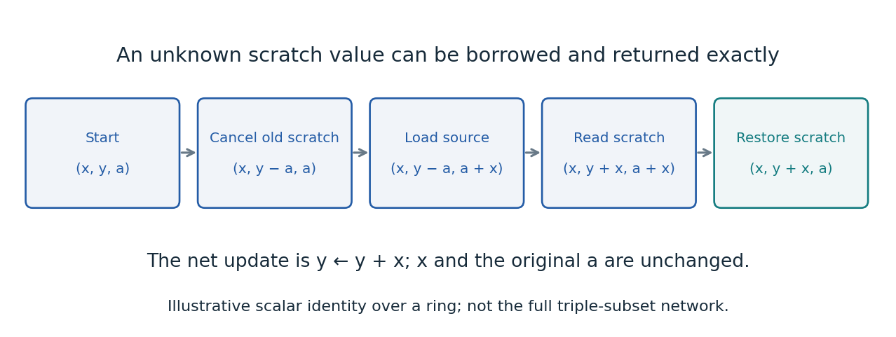
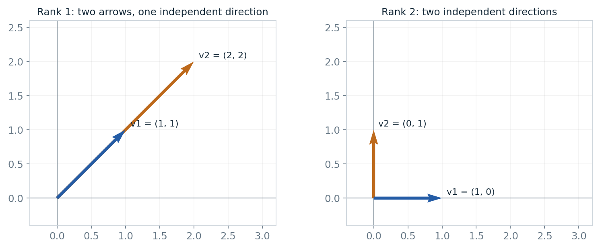
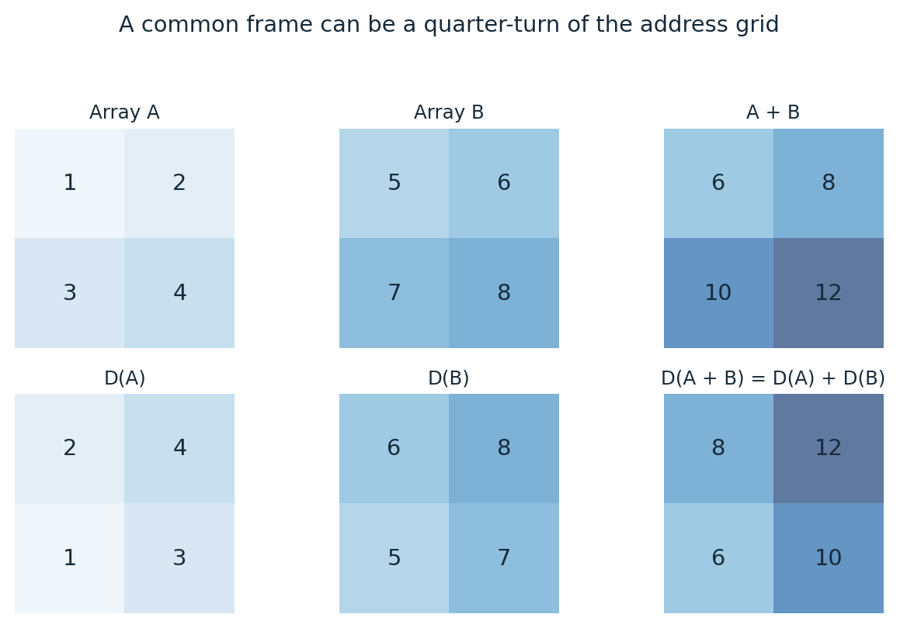
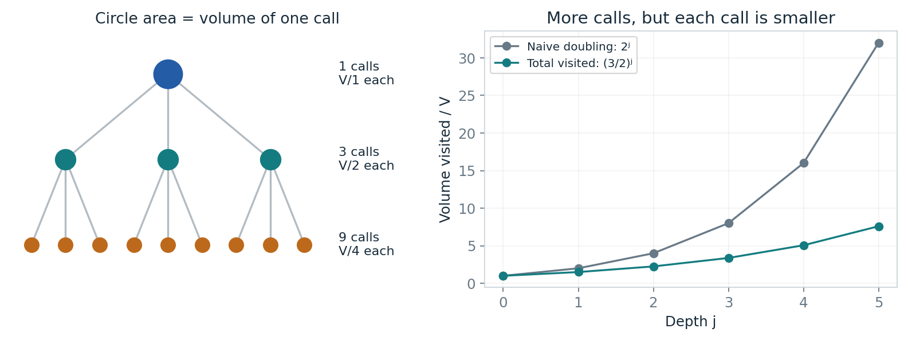
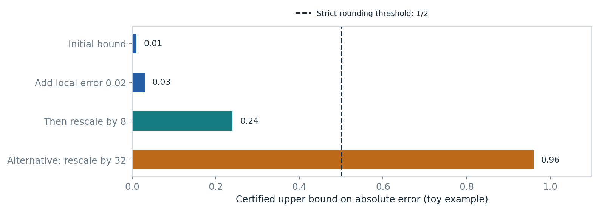
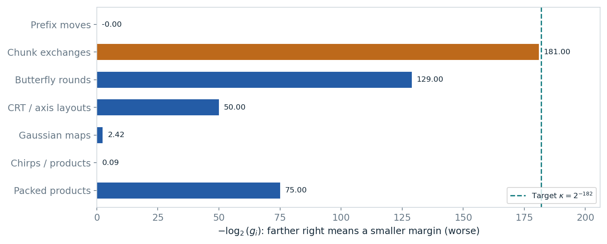

# Integer multiplication, illustrated

Part of [OpenAI math, illustrated](https://github.com/rohanarun/openai-math-illustrated), now including reading editions for van der Waerden numbers, Sidorenko, unit distances, sensitivity, and matrix multiplication.

How can multiplying enormous integers become cheaper than doing a full round of work at every logarithmic scale? This reading edition explains the proposed answer with **24 mathematical illustrations**, concrete examples, and the original proofs alongside the explanations.

- **[Read the illustrated guide — 31 pages](output/pdf/illustrated-guide.pdf)**
- **[Read the expanded paper — 105 pages](output/pdf/expanded-paper.pdf)**
- **[Download the editable sources and figures](output/integer-multiplication-editable-package.zip)**

The second edition introduces bits, logarithms, convolution, vectors, rank, complex numbers, and transforms before their technical use. Start with the pictures below. They show actual numerical contributions, array positions, register values, and geometric directions. The small examples illustrate the mechanisms; they are not the paper's enormous circuit or practical runtime benchmarks.

## Multiplication adds products along diagonals

In **23 × 14**, both `3 × 1` and `2 × 4` contribute to the tens position. The teal diagonal therefore adds to 11. The complete coefficient list is `[12, 11, 2]`; carrying turns it into the digits of **322**.



That grouping is **convolution**. A transform offers a different route to computing these same coefficients.

## A transform describes the same data using patterns

Add the four patterns point by point. At the first position, `4 + 3 + 0 + 1 = 8`; at the second, `4 + 0 + 1 − 1 = 4`. The result is exactly `[8, 4, 2, 2]`. The guide explains how this real-pattern description relates to complex Fourier coefficients and their normalization.



## Data movement has a price

The same 3 × 3 array can be read by rows or by columns. Every line below connects a particular record to its new physical position. On the paper's fixed-tape machine, a head must move through intervening cells; changing an indexing formula does not move the records for free.



## Workspace can be borrowed without erasing its contents

Start with source `x = 3`, target `y = 5`, and scratch register `a = 7`. Follow the four updates. The target ends at **8**, while the source stays **3** and scratch returns to **7**. The guide gives the symbolic identity showing why this works with arbitrary initial scratch values.



## Rank counts independent directions

The two arrows on the left lie on one line, so they need only one independent direction. The two on the right need two. A matrix can have many nonzero entries but low rank. The paper uses residual ranks to price smaller operations between representations.



## A common frame preserves addition

Here the frame `D` rotates a two-by-two address grid. Add the two top-left arrays, then rotate their sum. You get exactly the same array as rotating both inputs first and adding corresponding cells: **D(A + B) = D(A) + D(B)**.



The actual construction uses more sophisticated frames. This example makes the invariant visible: every input to a gate must use the same representation, and every change of representation must be charged.

## Count the size of the recursive calls

In this **toy recurrence**, three calls each process half the data, so their total visited volume is `1.5V`. At the next depth, nine calls each process `V/4`, totaling `2.25V`. The circle area represents one call's volume. The number of calls grows quickly, but their shrinking size makes the total grow more slowly than naive doubling.



This illustrates the paper's crucial comparison `s/W < m`. It does not establish the tape implementation or its overhead by itself.

## Approximation is safe only after the scales are restored

A toy error bound of `0.01`, plus a new error allowance of `0.02`, gives `0.03`. Restoring a scale of 8 gives `0.24`, safely below one half. An alternative scale of 32 gives `0.96`, which is too weak a bound to guarantee rounding to the correct integer. The last two bars are alternative cases.



## The original exponent is limited by its smallest cost margin

Unlike the toy examples above, this chart uses the **original paper's exact rational parameters**. The axis is `−log₂(margin)`, so farther right means a smaller margin. Chunk exchanges have margin `2^-181`; the original final saving is `κ = 2^-182`, leaving strict room for additional logarithmic factors.



These compare asymptotic exponents, not measured execution times. The guide also shows why improving a nonlimiting term may leave the final exponent unchanged.

## Reading scope

This independent edition explains OpenAI's *Integer multiplication below n log n*, dated September 23, 2026, at commit [`adc7f1241b42e322a6451854ab7e4b4c146bf78a`](https://github.com/openai/math/tree/adc7f1241b42e322a6451854ab7e4b4c146bf78a/preprints/Integer-multiplication-below-n-log-n-September-23-2026). It is not a live leaderboard of later community improvements.

The first pass develops intuition from ordinary arithmetic. Checking every original proof still requires linear algebra, Fourier analysis, and complexity theory. The original paper states its result as a theorem; this edition does not independently validate it. It distinguishes source claims, pedagogical examples, and the conditional interfaces retained by the [community research repository](https://github.com/CrocSwap/integer-mult-bounds). This is not an official OpenAI revision or endorsement.

## Editable contents

| Location | Contents |
| --- | --- |
| `foundations/` | Ten new prerequisite chapters with concrete examples |
| `explanations/` | Explanations connected to the original argument |
| `figures/` | 24 vector PDF illustrations and PNG previews |
| `original/` | Unmodified original manuscript sources |
| `illustrated-guide.tex` | Guide entry point |
| `expanded-paper.tex` | Annotated-paper entry point |
| `source-manifest.json` | Pinned upstream URLs and hashes |
| `example-checks.json`, `foundation-checks.json` | Checked arithmetic and diagram examples |
| `figure-manifest.json`, `verification.json` | Figure inventory and document checks |

## Rebuild

Use Python with NumPy and Matplotlib, plus Tectonic. The renderer also uses PyMuPDF and Pillow.

```sh
python3 generate_concrete.py
python3 build_editions.py
tectonic --keep-logs -o output/pdf illustrated-guide.tex
tectonic --keep-logs -o output/pdf expanded-paper.tex
python3 verify_and_render.py
python3 package_release.py
```

The complete figure entry point imports the earlier generators, then replaces schematic illustrations with concrete mathematical diagrams. Use it to reproduce the second edition. Outputs, temporary directories, caches, and previews stay on the mounted writable external SSD in the author's environment; see [README.txt](README.txt).

Checks cover original source hashes, digit convolution, scratch restoration, butterfly arithmetic, interpolation, Fourier-pattern reconstruction, shared-frame identities, intersection cancellation, permutation compatibility, illustrative error budgets, and the original seven rational margins. All PDF pages are rendered for visual review. These checks concern the documents and illustrative calculations, not the full asymptotic theorem.

## Attribution and license

Original manuscript: OpenAI, September 23, 2026. Its bibliography and source attribution are preserved. Added explanations, figures, and scripts were prepared with substantial OpenAI Codex assistance on October 12, 2026. See [NOTICE](NOTICE) and the [Apache-2.0 license](LICENSE).
